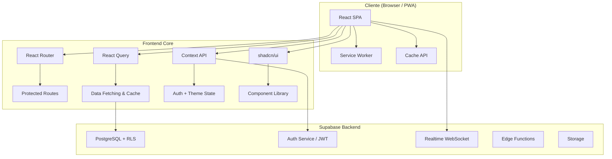

<div align="center">


# agendem

### O sistema de agendamento mais moderno para barbearias

[](https://react.dev)
[](https://www.typescriptlang.org)
[](https://supabase.com)
[](https://vitejs.dev)
[](https://tailwindcss.com)
[](https://web.dev/progressive-web-apps/)
[](LICENSE)

[✨ Demo ao vivo](#) · [📖 Documentação](#documentação) · [🐛 Reportar Bug](issues) · [💡 Sugerir Feature](issues)

</div>

---

## 📸 Visão Geral

**agendem** é uma plataforma SaaS completa para gestão de barbearias e salões de beleza. Com uma interface moderna e responsiva, conecta clientes a estabelecimentos, simplificando o agendamento online e a gestão do negócio — tudo direto pelo navegador, sem necessidade de downloads.

```
🗓️ Clientes agendam online 24h    →    📊 Barbeiros gerenciam tudo    →    ⭐ Avaliações constroem reputação
```

---

## ✨ Funcionalidades

### 👥 Para Clientes
- **Agendamento Online 24h** — escolha serviço, profissional, data e horário com horários livres em tempo real
- **Painel do Cliente** — histórico de agendamentos, preferências e favoritos
- **Avaliações & Feedback** — avalie o atendimento após cada visita
- **Perfil de Barbearia** — veja fotos, serviços, equipe e localização
- **Contato via WhatsApp** — botão de contato direto integrado

### 🏢 Para Barbearias (Admin/Funcionário)
- **Dashboard em Tempo Real** — agenda do dia, estatísticas e faturamento
- **Gestão de Agendamentos** — confirmar, cancelar, criar manualmente
- **Gerenciamento de Equipe** — cadastre funcionários, defina horários e pausas
- **Catálogo de Serviços** — preços, duração e profissionais responsáveis
- **Gestão de Férias** — controle de ausências e feriados da equipe
- **Feedbacks & Avaliações** — acompanhe a satisfação dos clientes
- **Perfil Compartilhável** — link/QR Code para divulgação nas redes sociais
- **Configurações Avançadas** — temas, notificações, horários de funcionamento
- **Planos & Assinaturas** — gerencie seu plano diretamente na plataforma

### 🔔 Notificações
- Alertas sonoros para novos agendamentos
- Configurações granulares de notificações
- Atualizações em tempo real via WebSocket

---

## 🛠️ Stack Tecnológica

| Camada | Tecnologia |
|---|---|
| **Frontend** | React 18 + TypeScript 5 |
| **Build Tool** | Vite 6 |
| **Estilização** | Tailwind CSS 3 + shadcn/ui |
| **Animações** | Framer Motion |
| **Backend / BaaS** | Supabase (PostgreSQL + Auth + Realtime + Storage) |
| **Serverless** | Supabase Edge Functions (Deno) |
| **State Management** | TanStack React Query v5 + Context API |
| **Formulários** | React Hook Form + Zod |
| **Roteamento** | React Router DOM v6 |
| **Gráficos** | Recharts |
| **PWA** | Service Worker + Web App Manifest |
| **Testes** | Vitest + Testing Library |
| **Email** | Resend API |

---

## 🏗️ Arquitetura



### Papéis de Usuário (Roles)

| Role | Acesso |
|---|---|
| `cliente` | Agendamento, painel pessoal, histórico, avaliações |
| `funcionario` | Dashboard, agenda do dia, agendamentos, feedbacks |
| `admin` | Tudo do funcionário + equipe, serviços, configurações, assinatura |

### Segurança
- **Row Level Security (RLS)** em todas as tabelas do PostgreSQL
- **JWT tokens** com refresh automático via Supabase Auth
- **Validação** de inputs com Zod em todos os formulários
- **Rate limiting** client-side para operações sensíveis
- **Variáveis de ambiente** para todas as credenciais (nunca hardcoded)

---

## 📁 Estrutura do Projeto

```
agendem-barbearia/
├── 📁 public/                    # Assets estáticos e PWA
│   ├── 📁 icons/                # Ícones PWA (48px → 512px)
│   ├── 📄 manifest.json         # Web App Manifest
│   ├── 📄 sw.js                 # Service Worker
│   └── 📄 offline.html          # Página offline
│
├── 📁 src/
│   ├── 📁 components/           # Componentes reutilizáveis
│   │   ├── 📁 ui/               # shadcn/ui base components
│   │   ├── ErrorBoundary.tsx
│   │   ├── ProtectedRoute.tsx
│   │   └── PWAInstallPrompt.tsx
│   ├── 📁 contexts/             # Auth + Theme contexts
│   ├── 📁 hooks/                # Custom hooks (auth, realtime, roles…)
│   ├── 📁 integrations/         # Supabase client + tipos gerados
│   ├── 📁 layouts/              # DashboardLayout
│   ├── 📁 lib/                  # Utilitários, logger, validações
│   ├── 📁 pages/                # Todas as páginas da aplicação
│   ├── 📁 providers/            # ThemeProvider
│   └── 📁 __tests__/            # Testes unitários
│
├── 📁 database/migrations/      # Migrações SQL versionadas
├── 📁 supabase/functions/       # Edge Functions (Deno)
├── 📁 scripts/                  # Scripts utilitários
├── .env.example                 # Template de variáveis de ambiente
├── ARCHITECTURE.md              # Documentação de arquitetura
├── netlify.toml                 # Deploy Netlify
└── vercel.json                  # Deploy Vercel
```

---

## 🚀 Como Rodar Localmente

### Pré-requisitos

- [Node.js](https://nodejs.org) >= 20
- [npm](https://npmjs.com) ou [pnpm](https://pnpm.io)
- Conta no [Supabase](https://supabase.com) (gratuita)

### 1. Clone o repositório

```bash
git clone https://github.com/seu-usuario/agendem-barbearia.git
cd agendem-barbearia
```

### 2. Instale as dependências

```bash
npm install
```

### 3. Configure as variáveis de ambiente

```bash
cp .env.example .env
```

Edite o `.env` com suas credenciais:

```env
# Supabase
VITE_SUPABASE_URL=https://xxxxxxxxxxxx.supabase.co
VITE_SUPABASE_ANON_KEY=sua_anon_key_aqui

# Ambiente
NODE_ENV=development

# Resend (para e-mails de convite de funcionários)
RESEND_API_KEY=sua_resend_api_key_aqui

# Opcional: Sentry (monitoramento de erros)
VITE_SENTRY_DSN=seu_sentry_dsn_aqui
```

### 4. Configure o banco de dados

Aplique as migrações na ordem no seu projeto Supabase:

```
database/migrations/
├── 001_tipos_e_tabelas.sql
├── 002_funcoes.sql
├── 003_gatilhos_e_views.sql
├── 004_seguranca_rls.sql
├── 005_storage_realtime_e_dados.sql
├── 006_senha_provisoria_e_conflitos.sql
└── 007_remove_fidelidade_e_convites.sql
```

### 5. Inicie o servidor de desenvolvimento

```bash
npm run dev
```

Acesse `http://localhost:5173` 🎉

### Login do cliente com Google

1. Aplique `database/migrations/011_login_google_cliente.sql` no projeto Supabase.
2. Em **Authentication → Hooks**, configure **Custom Access Token** para usar a função PostgreSQL `public.restringir_login_social_equipe`. Se o projeto já usa um hook desse tipo, incorpore a regra ao hook existente.
3. Crie um cliente OAuth do tipo **Aplicativo da Web** no Google Cloud. Use como URI de redirecionamento a URL de callback exibida pelo provedor Google no Supabase.
4. Em **Authentication → URL Configuration**, permita a URL do site com o caminho `/client-login`. Para testar localmente, permita também `http://localhost:5173/client-login`.
5. Em **Authentication → Sign In / Providers → Google**, insira o Client ID e o Client Secret e ative o provedor. O botão passa a aparecer na tela de login do cliente.

[Configurar o provedor Google](https://supabase.com/docs/guides/auth/social-sign-in/auth-google) · [Configurar o Auth Hook](https://supabase.com/docs/guides/auth/auth-hooks/custom-access-token-hook)

---

## 🧪 Testes

```bash
# Rodar testes unitários
npm test

# Rodar testes com interface visual
npm run test:ui
```

A suíte de testes cobre:
- Componentes (`ProtectedRoute`, `DayPicker`)
- Hooks (`useUserRole`, `useRealtimeSubscription`)
- Utilitários (`agenda`, `horários`, `auth-errors`, `logger`)

---

## 📦 Build e Deploy

### Build de produção

```bash
npm run build
```

Os arquivos de saída ficam em `/dist`, otimizados com:
- **Code splitting** por rota (lazy loading)
- **Minificação** com Terser
- **Chunks separados** para vendor, UI, charts e features

### Deploy

O projeto suporta deploy em múltiplas plataformas:

| Plataforma | Configuração |
|---|---|
| **Vercel** | `vercel.json` incluído |
| **Netlify** | `netlify.toml` incluído |

---

## 📱 PWA — Progressive Web App

O **agendem** é um PWA completo. Os usuários podem instalar o app direto do navegador (sem loja de apps) e contar com:

- ✅ **Funciona offline** (Service Worker com cache estratégico)
- ✅ **Instalável** no iOS, Android e Desktop
- ✅ **Ícones e splash screen** para todas as resoluções
- ✅ **Background Sync** — sincroniza dados quando a conexão voltar

---

## 🗺️ Rotas da Aplicação

| Rota | Descrição | Acesso |
|---|---|---|
| `/` | Seleção de tipo de usuário | Público |
| `/sobre` | Landing page | Público |
| `/barbearias` | Lista de barbearias | Público |
| `/barbearia/:slug` | Perfil da barbearia | Público |
| `/agendamento` | Fluxo de agendamento | Público |
| `/login` | Login de admin/funcionário | Público |
| `/client-login` | Login de cliente | Público |
| `/register-barbershop` | Cadastro de barbearia | Público |
| `/client-panel` | Painel do cliente | `cliente` |
| `/meus-agendamentos` | Histórico de agendamentos | `cliente` |
| `/dashboard` | Dashboard (hoje) | `funcionario` |
| `/dashboard/agenda` | Agenda completa | `funcionario` |
| `/dashboard/agendamentos` | Lista de agendamentos | `funcionario` |
| `/dashboard/feedbacks` | Avaliações recebidas | `funcionario` |
| `/dashboard/services` | Gestão de serviços | `admin` |
| `/dashboard/team` | Gestão de equipe | `admin` |
| `/dashboard/settings` | Configurações da barbearia | `admin` |
| `/dashboard/ferias` | Gestão de férias | `admin` |
| `/dashboard/share-profile` | Link/QR de divulgação | `admin` |
| `/dashboard/subscription` | Planos e assinaturas | `admin` |

---

## 🤝 Contribuindo

Contribuições são bem-vindas! Para contribuir:

1. Faça um fork do projeto
2. Crie uma branch para sua feature: `git checkout -b feat/minha-feature`
3. Commit suas alterações: `git commit -m 'feat: adiciona minha feature'`
4. Faça push para a branch: `git push origin feat/minha-feature`
5. Abra um Pull Request

Por favor, siga o padrão de commits [Conventional Commits](https://www.conventionalcommits.org/pt-br/).

---

## 📄 Documentação Adicional

| Documento | Descrição |
|---|---|
| [ARCHITECTURE.md](ARCHITECTURE.md) | Arquitetura detalhada do sistema |
| [PWA_GUIDE.md](PWA_GUIDE.md) | Guia completo do Progressive Web App |
| [database/README.md](database/README.md) | Documentação do banco de dados |

---

## 📄 Licença

Este projeto está sob a licença MIT. Veja o arquivo [LICENSE](LICENSE) para mais detalhes.

---

<div align="center">

Feito com ❤️ para barbearias modernas

**agendem** · Agendamento online, gestão completa, sem complicação

</div>
