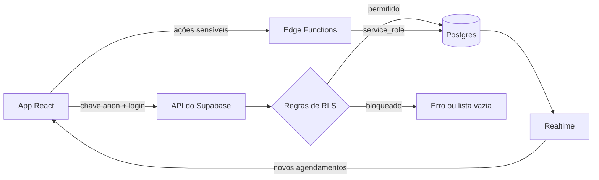
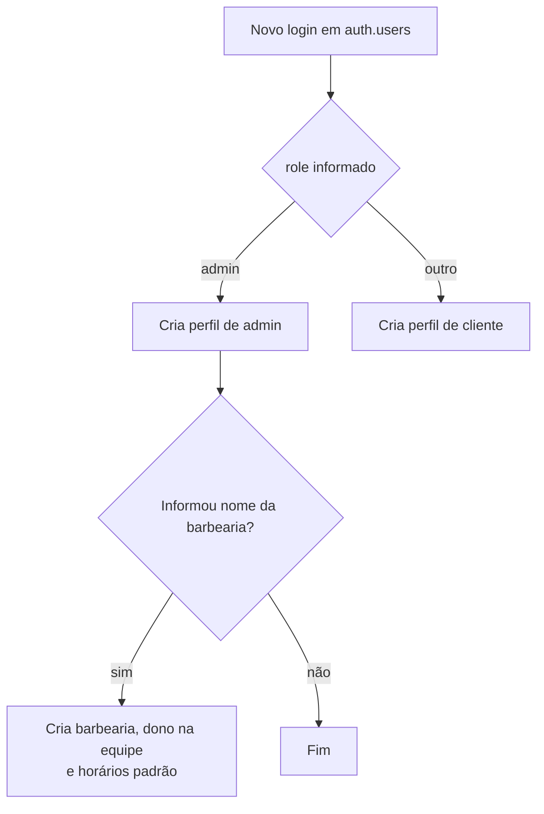
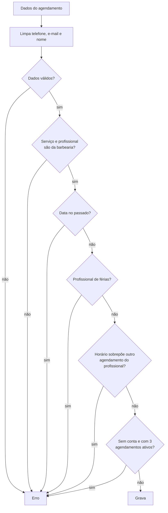
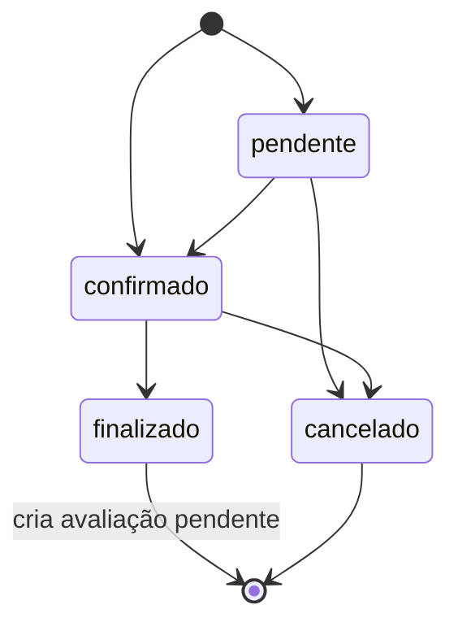
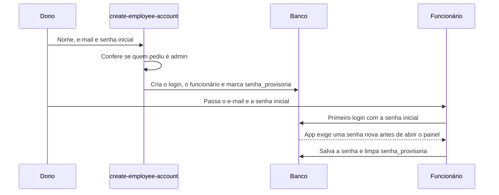

# Banco de dados do Agendem

Tudo o que existe no banco está nesta pasta, em SQL comentado. O projeto Supabase é o
`frwijltveksvxnyakuze`, e o app se conecta a ele pelas variáveis do arquivo `.env`.

## Como a pasta está organizada

Os arquivos de `migrations/` rodam em ordem, uma única vez, em um banco vazio.

| Arquivo | Conteúdo |
| --- | --- |
| `001_tipos_e_tabelas.sql` | Tipos, tabelas, relacionamentos e índices |
| `002_funcoes.sql` | Regras de negócio e validações |
| `003_gatilhos_e_views.sql` | Ações automáticas e views públicas |
| `004_seguranca_rls.sql` | Quem pode acessar o quê |
| `005_storage_realtime_e_dados.sql` | Imagens, tempo real e categorias iniciais |
| `006_senha_provisoria_e_conflitos.sql` | Senha inicial de funcionários e bloqueio de conflito de horário |
| `007_remove_fidelidade_e_convites.sql` | Remove o programa de fidelidade e os convites por e-mail |

Para mudar o banco, crie um arquivo novo (`006_...sql`) em vez de editar um já aplicado.

## Visão geral

A chave `anon` fica no navegador e é pública por natureza: quem protege os dados é o RLS.
A chave `service_role` ignora o RLS e deve existir só nas Edge Functions.

## Papéis

| Papel | Quem é | O que faz |
| --- | --- | --- |
| Visitante (`anon`) | Sem login | Vê a vitrine e agenda sem conta |
| `cliente` | Conta de cliente | Agenda, acompanha e avalia |
| `funcionario` | Equipe | Gerencia agenda, pausas e avaliações |
| `admin` | Dono da barbearia | Tudo acima, mais equipe, serviços, horários e configurações |

Dentro da equipe, a coluna `funcionarios.nivel` (`funcionario`, `gerente`, `dono`) guarda
o cargo. O papel que vale para a segurança é sempre `profiles.role`.

## Cadastro

A função `handle_new_user` roda sozinha quando o Supabase cria um login.

## Agendamento

A função `validar_agendamento` roda antes de gravar qualquer agendamento.

Depois de gravado, o agendamento segue este ciclo:

A agenda pública e a tela de novo agendamento usam a função `horarios_ocupados`, que informa
os horários reservados sem expor nome ou telefone de clientes. Elas só mostram horários dentro
do expediente, ainda não passados e livres de pausas e férias. A sobreposição considera a
duração do serviço, e o banco repete essa checagem ao gravar para impedir reservas simultâneas.

## Cadastro de funcionário

O dono define nome, e-mail e uma senha inicial. Não há convite por e-mail.

## Edge Functions

O código fica em `supabase/functions/`. Todas validam o login dentro da própria função.

| Função | O que faz |
| --- | --- |
| `create-employee-account` | Cria a conta de um funcionário |
| `delete-employee` | Exclui um funcionário da barbearia de quem pediu |
| `delete-client-account` | Exclui a conta do próprio cliente |
| `delete-barbershop` | Exclui a barbearia de quem pediu e a conta dele |

## Imagens

Os buckets públicos `logos` e `gallery` aceitam imagens de até 5 MB. Cada arquivo fica em
uma pasta com o id da barbearia, e só o admin dela pode enviar, trocar ou remover.

## Configurações fora do SQL

Estes ajustes ficam no painel do Supabase ou na hospedagem:

- **Confirmação de e-mail:** em Authentication > Sign In / Providers. O app foi feito com ela
  desligada; ligada, a pessoa precisa confirmar o e-mail antes de entrar.
- **URLs de autenticação:** em Authentication > URL Configuration, informe o domínio do app.
- **Variáveis da hospedagem:** `VITE_SUPABASE_URL` e `VITE_SUPABASE_ANON_KEY` na Netlify ou
  Vercel. O arquivo `.env` local não vai para o git.
- **Stripe:** as funções de assinatura ainda não foram publicadas neste projeto.
